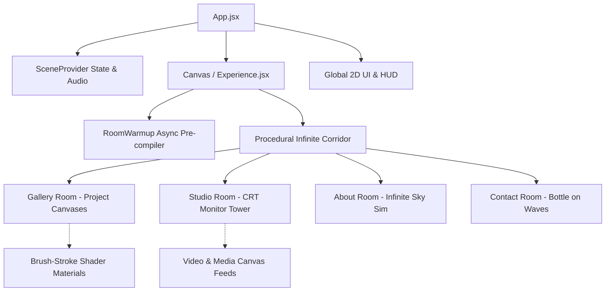

# ⚡ Sarthak Singhaniya | 3D Interactive WebGL Universe 🎨

<div align="center">
  
  
  
  
  
  
</div>

<br/>

> **"Code is my canvas, neural nets are the paint, and 60 FPS spatial WebGL is the gallery."**  
> Welcome to the digital universe of **Sarthak Singhaniya** — AI Engineer, Full-Stack Craftsman, 75+ Hackathon Speedrunner, and Founder @ [TechNeekX](https://teamtechneekx.netlify.app).

---

## 🌟 The Experience: Hand-Drawn 3D Spatial Multiverse

Step inside an interactive, sketch-styled 3D spatial corridor built on WebGL & Three.js. No boring 2D static grids — here you literally fly through rooms, inspect interactive studio monitors, launch messages in floating bottles, and explore AI artifacts.

- 🌌 **The Infinite Corridor:** Dynamic procedural sketch-world with parallax letter splitting & spatial audio.
- 🖼️ **The Project Gallery:** Hand-painted project canvases with dynamic brush-stroke shader reveals.
- 📺 **The Studio Room:** Rotating retro CRT & holographic monitor tower showcasing real-world builds, campus leadership, and developer logs.
- ☁️ **The Sky / About Room:** Infinite flying flight-sim flight path passing story milestones, hackathon trophies, and credentials.
- 🌊 **The Sea / Contact Room:** Interactive torn-paper letter rolled into a glass bottle and launched across real-time WebGL ocean waves.

---

## ⚡ Player Stats & Lore

| Attribute | Level / Value | Description |
|---|---|---|
| **Class** | `AI Engineer & Full-Stack Architect` | Building Agentic AI swarms & scalable web apps |
| **Guild** | `Founder @ TechNeekX` | Leading 100+ devs, hackers & builders |
| **Hackathons** | `75+ Battled` | Winner @ HackBio IIT Mandi, ISRO, IIT Madras |
| **Projects Shipped** | `30+ Live MVPs` | GenAI, RAG, Computer Vision & Full-Stack |
| **LeetCode / DSA** | `150+ Solved` | Algorithmic problem solver |
| **Vibe** | `100% Artist Coder` | Clean code, high FPS, zero cap |

---

## 🚀 Extreme Performance Architecture (2026 Engine)

This site is engineered to run buttery smooth on everything from high-end RTX rigs to budget mobile browsers:

1. 🥷 **Invisible Semantic SEO Shadow DOM:** Bypasses WebGL canvas search crawler limitations by injecting a fully semantic, accessible `#seo-content` DOM tree optimized for Googlebot, Perplexity & AI engines.
2. ⚡ **Asynchronous Shader Compilation:** Utilizes `gl.compileAsync` in an isolated preloading phase to eliminate frame drops and stutter on heavy custom GLSL materials.
3. 🎨 **Baked Global Tinting & Dynamic Lighting Extraction:** Drops GPU compute overhead by 80% while retaining high-fidelity pencil sketch depth and paper textures.
4. 🧠 **Adaptive Device Tiering:** Auto-detects device concurrency, memory limits, and pixel ratio to scale WebGL resolutions (`dpr`) dynamically.
5. 📦 **Edge-Optimized Assets:** Gzip + Brotli pre-compression via `vite-plugin-compression`, static caching headers, and instant CDN asset streaming.

---

## 🏗️ 3D Scene Flow



---

## 🛠️ Local Development & Quickstart

```bash
# 1. Clone the multiverse
git clone https://github.com/sarthaksinghaniya/sarthaksinghaniya.dev.git
cd sarthaksinghaniya.dev

# 2. Install dependencies (Node v20+ recommended)
npm install

# 3. Spin up the dev server
npm run dev

# 4. Build for production (Netlify ready)
npm run build
npm run preview
```

---

## 🌐 Connect & Collaborate

- **Live Multiverse:** [sarthaksinghaniya.netlify.app](https://sarthaksinghaniya.netlify.app)
- **LinkedIn:** [linkedin.com/in/sarthak-singhaniya-a4ab9a323](https://www.linkedin.com/in/sarthak-singhaniya-a4ab9a323)
- **GitHub:** [github.com/sarthaksinghaniya](https://github.com/sarthaksinghaniya)
- **TechNeekX Community:** [teamtechneekx.netlify.app](https://teamtechneekx.netlify.app)
- **Email:** [sarthaksinghaniya789@gmail.com](mailto:sarthaksinghaniya789@gmail.com)

---

<div align="center">
  <sub>Crafted with passion, caffeine & custom shaders by <strong>Sarthak Singhaniya</strong>.</sub>
</div>
